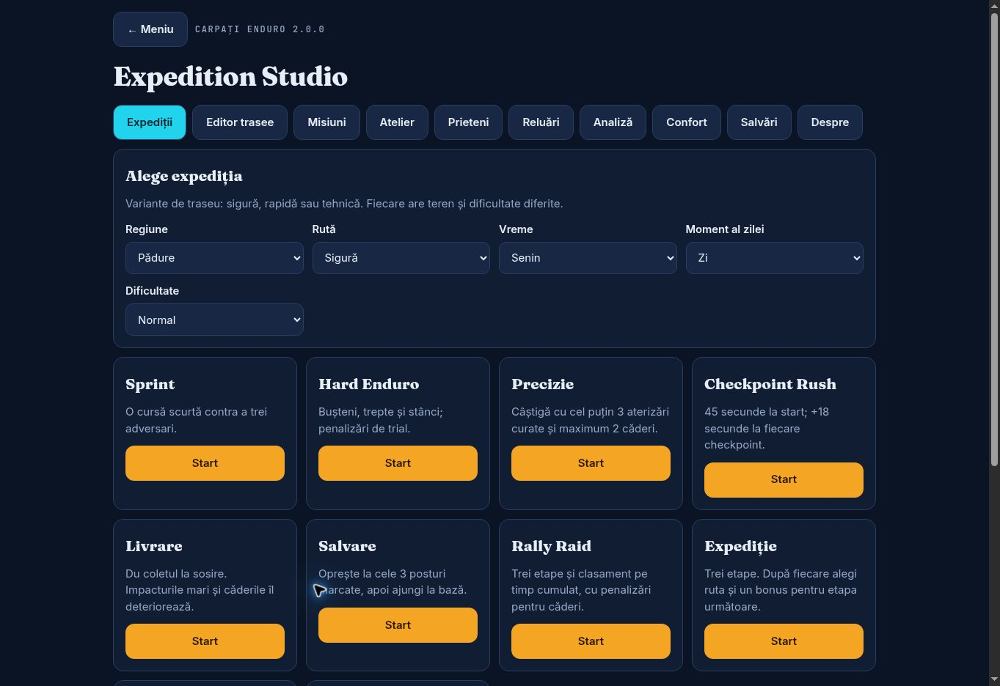

# Expedition 2.0 — verificări, 29 octombrie 2026

## Confirmat automat

- `node --check`: JavaScript-ul jocului, nucleul de date și service worker-ul.
- 10 teste Node pentru trasee, importuri, migrarea progresului, misiuni, validarea ghosturilor și separarea regulilor de clasament.
- 3 teste Node pentru service worker: curățare limitată la cache-urile jocului, existența shell-ului offline și ignorarea altor aplicații/hosturi.
- 3 teste Node în patch-ul Arcade World: contract valid de rezultat, respingerea origin/source/session greșite și respingerea datelor nevalide.
- 20 de scenarii în browserul Chromium al previzualizării, inclusiv:
  - cele 8 regiuni × 9 moduri originale pornesc și simulează fără coordonate nefinite;
  - cele 10 discipline noi generează teren finit și pornesc;
  - cele 10 secțiuni Studio în RO și EN;
  - lățimi de 320, 390 și 768px cu text 130%, fără overflow orizontal al panoului;
  - teren reproductibil, suprafață configurată și cod de traseu cu diacritice;
  - geometria expediției păstrată în replay;
  - efectul presiunii asupra aderenței/vitezei;
  - bonus activabil o singură dată și categorii separate după reguli;
  - antrenament fără monede/XP și recompense neduplicate;
  - expirarea Checkpoint Rush și blocarea finalizării fără obiective;
  - replay cu poziții finite, respingerea importului invalid și checkpoint reluat ca antrenament;
  - rezultate întârziate care nu redeschid o cursă abandonată;
  - nicio eroare de execuție în joc în timpul acestor scenarii.

`tests/runtime.html` este un harness de previzualizare pe un origin de test; nu este un benchmark și nu dovedește finalizarea manuală a fiecărui traseu. Testarea la lățimi mobile folosește un iframe, nu un telefon fizic.

Previzualizarea Chromium nu a putut crea un context WebGL; jocul a pornit corect prin alternativa 2D. Scenariile de execuție de mai sus verifică această alternativă, nu randarea 3D.

## Neconfirmat

- Frame pacing, temperatură și autonomie pe un telefon fizic.
- Folosirea completă cu un cititor de ecran și accesibilitatea motorului vizual în timp real.
- Instalarea și relansarea din modul avion pe Android/iOS.
- Paritatea vizuală 2D/3D pentru fiecare combinație de traseu, vreme și cameră.
- Echilibrarea tuturor etapelor, dificultăților și claselor prin sesiuni lungi de joc.
- Deployment-ul GitHub Pages al acestei versiuni: modificările sunt propuse în PR.

## Limite funcționale explicite

- Relay/multiplayer live, conturi, cloud și clasamente globale: fără backend conectat.
- Jocul cu prietenii este pe rând pe același dispozitiv sau prin ghost importat; nu este split-screen.
- Reluările păstrează poziții înregistrate, nu reexecută determinist toate acțiunile fizice.
- Fotografia exportată este o randare 2D de 1200×675, inclusiv atunci când jucătorul folosește 3D.
- Timpii rivalilor care nu au sosit încă în Rally Raid sunt estimați și sunt etichetați astfel.
- Save Run păstrează checkpointul pentru o încercare nouă de antrenament; nu promite reluarea exactă a cronometrului, AI-ului și obiectelor.
- Numai ultima reluare și 60 de rezultate recente sunt păstrate pentru a limita stocarea locală.

Vezi FEATURE-COVERAGE.md pentru toate cele 24 de direcții și subpunctele rămase.
