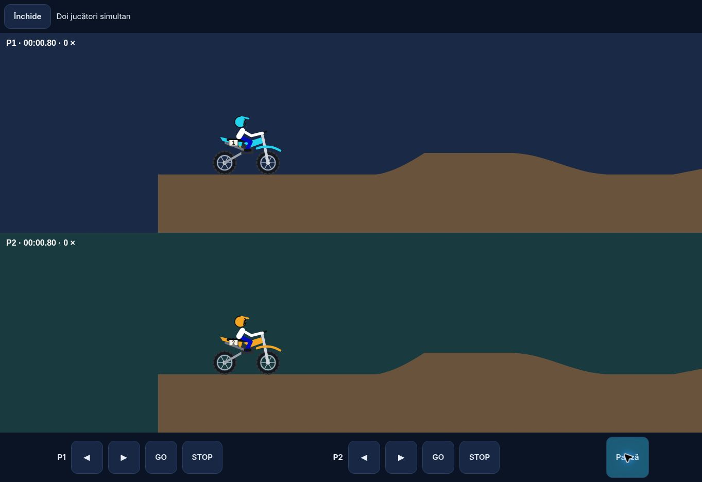

# Expedition 2.1 — verificări, 29 octombrie 2026

## Confirmat local

- Sintaxa scriptului principal, a nucleului de date, a sistemelor avansate, a service worker-ului și a serverului Node.
- **24 teste Node în joc:** 10 contracte de date, 8 sisteme avansate, 3 scenarii server și 3 contracte de cache. Integrarea Arcade World are separat **3 teste** de validare a mesajelor.
- **27 scenarii în browserul Chromium al previzualizării:** RO/EN și cele 10 panouri Studio; lățimi 320/390/768px cu text 130%; inițializare/simulare pentru 8 regiuni × 9 moduri originale; cele 10 probe noi; teren reproductibil și coduri cu diacritice; geometria reluării; reglaje fizice; categorii de record; bonus unic; recompense idempotente; antrenament fără monede/XP; timeout și obiective; seek; import respins; checkpoint reluat; timer-e izolate; persistența sistemelor avansate; AI pe roți; ramificație care schimbă suprafața de coliziune; platforme/checkpointuri plasate; motociclete independente în split-screen; ghost demonstrativ finit; nicio destinație/identitate online inventată și nicio eroare de execuție în scenarii.
- Testele serverului fac cereri HTTP reale către un server temporar, cu parole sintetice și director temporar: login/hash salvat, origini respinse, acces neautentificat, separarea utilizatorilor, două uploaduri concurente (200/409), rolul gazdei/readiness, poziții live și rezultat idempotent.
- Split-screen inspectat vizual: două motociclete, două zone de teren și comenzi independente; pauză comună.
- Tutorial generat și descărcat prin aplicație. `ffprobe`: WebM/VP8, 960×540, aproximativ 10,16 secunde pentru fișierul exportat.
- ZIP itch.io verificat cu `ZipFile.testzip()`: `index.html` la rădăcină, scripturi, manifest, iconițe și tutorial prezente.
- Workflow Node dedicat inclus. Rezultatele locale de mai sus nu reprezintă confirmarea automată a rulării sale în GitHub CI.

## Neconfirmat și limite

- Browserul de previzualizare nu poate crea un context WebGL; verificările vizuale/de execuție folosesc alternativa **2D**. Randarea 3D completă a noilor obiecte și echipamente rămâne de verificat pe un dispozitiv cu WebGL.
- Lățimile mobile sunt testate prin iframe. Aceste verificări nu măsoară frame pacing, temperatură sau autonomie pe un telefon real.
- Nu există încă un server HTTPS de producție configurat. Testele API nu reprezintă o sesiune de browser între două telefoane. Conturile/lobby-ul/cloud-ul nu sunt prezentate drept servicii publice deja active.
- Auditul real cu cititor de ecran, instalarea/relansarea în mod avion și echilibrarea prin sesiuni lungi rămân neconfirmate.
- Reluările redau poziții înregistrate; nu reexecută determinist toate inputurile. Ramificațiile și marcajele sunt incluse, dar modelul nu promite reproducerea volumetrică a urmelor.
- Foto export folosește randarea 2D, cu filtre aplicate imaginii finale.
- Timpii rivalilor nesosiți în Rally Raid sunt estimați și etichetați astfel.
- Checkpoint resume începe o încercare nouă de antrenament; nu promite restaurarea exactă a timpului și AI-ului.
- În multiplayer, HTTP polling introduce latență; clasamentul este comunitar, fără validare anti-cheat completă prin re-simulare.
- ZIP-ul este pregătit pentru itch.io, dar nu a fost urcat într-un cont. PR-urile rămân separate de deployment-ul public.

Pentru acoperirea celor 24 de direcții, vezi FEATURE-COVERAGE.md. Pentru server și găzduire, vezi server/README.md.
